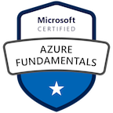
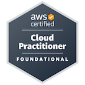
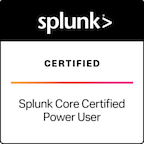
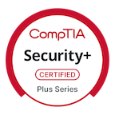
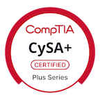
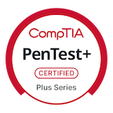
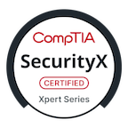

# Hi, I'm Sadie 👋

I'm a systems engineer who's always tinkering with something new. I build monitoring that catches problems before anyone notices them, and I automate anything I have to do twice. Lately I've gone all the way down to the hardware: I'm learning how to design computer chips. 🧠

- 🔭 **Currently building:** [chip-design](https://github.com/zerotrustprivacy/chip-design), my path from C++ to Verilog to a chip of my own
- 🌱 **Learning:** chip design and design verification
- 📝 **Writing:** [techsavvysadie.substack.com](https://techsavvysadie.substack.com)
- ⚡ **Fun fact:** 10 certifications and still collecting

 

### 🛠️ Tools I use

…plus a whole lot of **Splunk** 📊

### 🚀 Things I've built

| | Project | What it does |
|---|---|---|
| 🔌 | [chip-design](https://github.com/zerotrustprivacy/chip-design) | Learning chip design from the ground up, tested automatically with GitHub Actions |
| 🏗️ | [terraform-infra](https://github.com/zerotrustprivacy/terraform-infra) | Azure infrastructure with Terraform and the Azure CLI |
| 🌍 | [learn-terraform](https://github.com/zerotrustprivacy/learn-terraform) | Terraform from the very beginning |
| ☁️ | [learn-terraform-azure](https://github.com/zerotrustprivacy/learn-terraform-azure) | Building infrastructure in Azure |
| 📈 | [grafana_prometheus_setup](https://github.com/zerotrustprivacy/grafana_prometheus_setup) | Monitoring with Prometheus and Grafana |
| 🧩 | [json-parser](https://github.com/zerotrustprivacy/json-parser) | Parsing JSON files with Python |

### 🏅 Certifications

  
  
  
  
  
   
  
  
  
  
  

---

<i>"Continuous learning and experimentation fuel everything I build."</i> 💜

